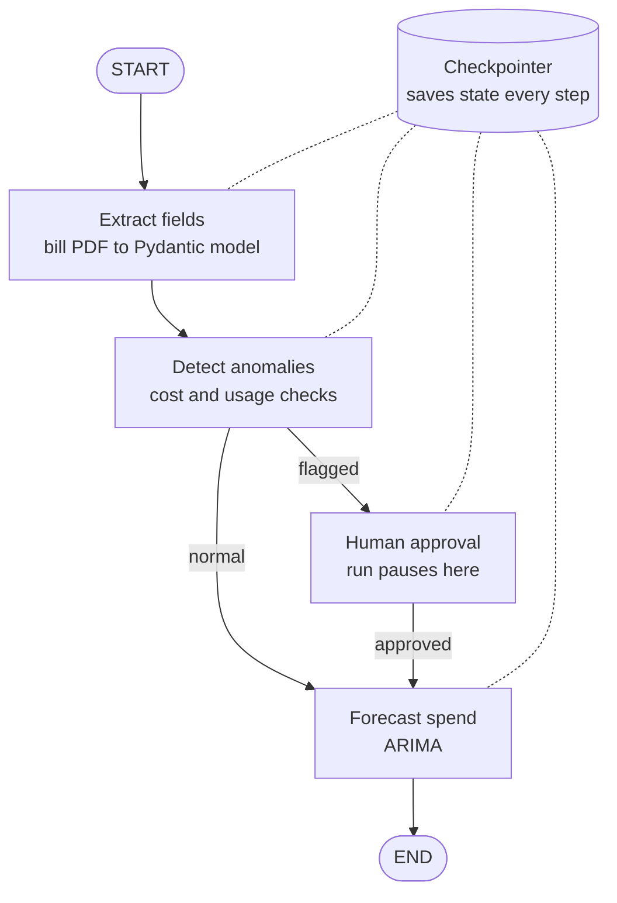

# EnergyGuard

**A LangGraph agent that reads electricity bill PDFs, flags cost and usage anomalies, and forecasts spend, with a human approving anything it flags.**


<!-- TODO: add a 30–60 second demo GIF here: upload a bill, see the extracted fields, see a flagged anomaly wait for approval, then the forecast.
 -->

## Why this exists

Facilities and finance teams receive many electricity bills and catch overcharges or usage spikes late, if at all. EnergyGuard reads each bill, checks it against expected cost and usage, and asks a person to review anything unusual before it goes through.

## Features

- **Structured extraction:** pulls bill fields from PDFs into validated Pydantic models.
- **Anomaly detection:** checks cost and usage for unusual values.
- **Spend forecasting:** projects upcoming spend with ARIMA.
- **Human-in-the-loop:** flagged bills pause for a person to approve before the run continues.
- **Checkpointing:** graph state is saved at every step, so an interrupted run resumes where it stopped instead of starting over.
- **Measured accuracy:** field-level extraction accuracy checked against ground truth from synthetic bills.

## Agent graph



## How human-in-the-loop works

1. When a bill is flagged, the graph pauses before continuing and its state is saved by the checkpointer.
2. A reviewer sees the bill, the extracted fields and why it was flagged.
3. After the reviewer's decision, the same run resumes from the saved state.

<!-- TODO: describe your reviewer UI or API call, and what happens when a bill is rejected. -->

## Tech stack

| Layer | Tools |
| --- | --- |
| Agent orchestration | LangGraph |
| Structured extraction | Pydantic, <!-- TODO: name the LLM you use --> |
| Forecasting | ARIMA |
| API | FastAPI |
| UI | Streamlit |

## Evaluation

I measured extraction accuracy field by field against ground truth from synthetic bills.

<!-- TODO: replace with your fields and results. The field names below are examples. -->

| Field | Accuracy |
| --- | --- |
| Billing period (example) | TODO |
| Units consumed (example) | TODO |
| Total amount (example) | TODO |
| **Overall** | TODO |

**What I learned:** <!-- TODO: 2–3 bullets, e.g. which fields were hardest to extract and how you improved them. -->

## Getting started

> Update these commands to match your code.

```bash
git clone https://github.com/Praveenasuku/energyguard.git
cd energyguard
cp .env.example .env              # add your API keys
pip install -r requirements.txt
```

<!-- TODO: how to start the API and the Streamlit app, and where to put sample bills. -->

## Project structure

<!-- TODO: paste the output of `tree -L 2` once the code is pushed. -->

## Related projects

- [DC-Ops Copilot](https://github.com/Praveenasuku/dc-ops-copilot): a production RAG assistant for data centre operations.
- [DC-Ops MCP Server](https://github.com/Praveenasuku/dc-ops-mcp-server): exposes this agent as a tool for any MCP client.

## Author

**Praveena S**, Generative AI Engineer
[LinkedIn](https://www.linkedin.com/in/praveena-suku/) · [GitHub](https://github.com/Praveenasuku)
